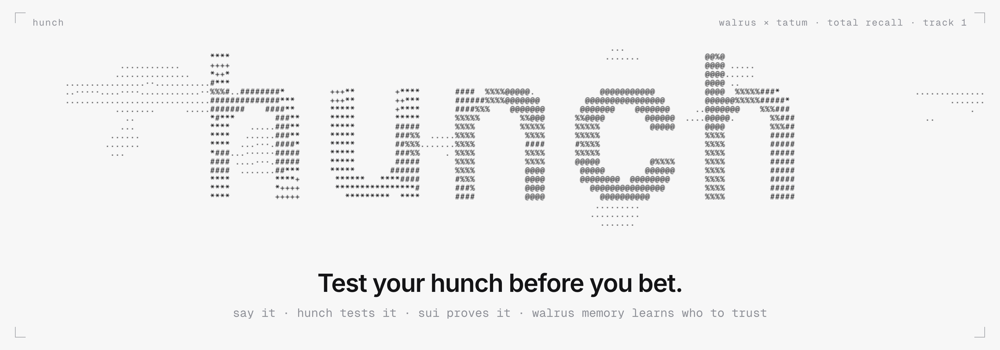
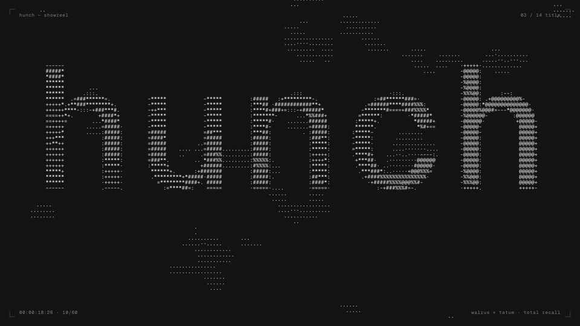
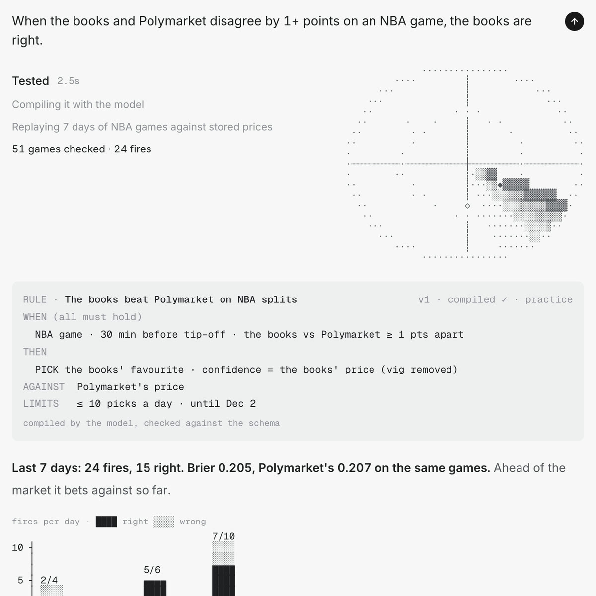
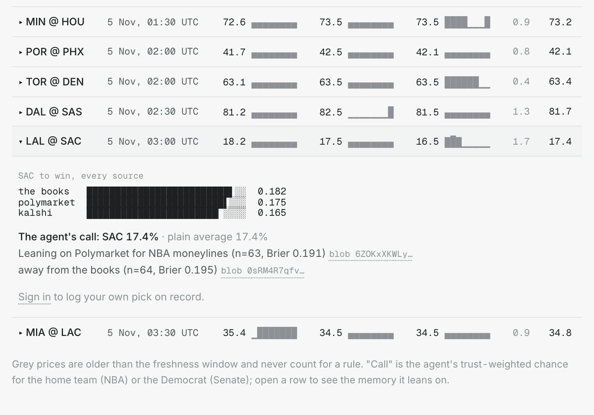
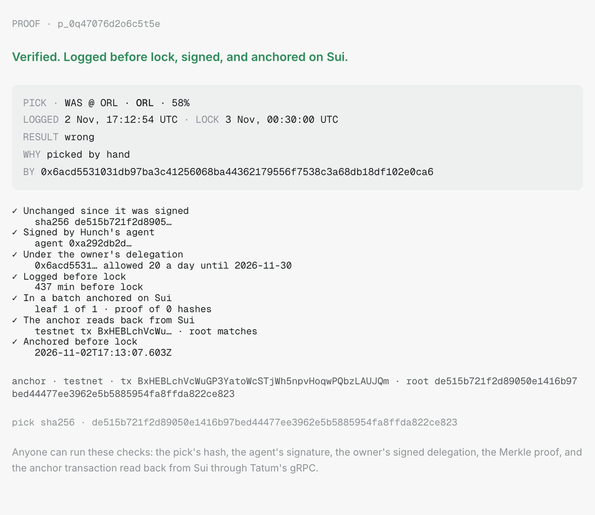
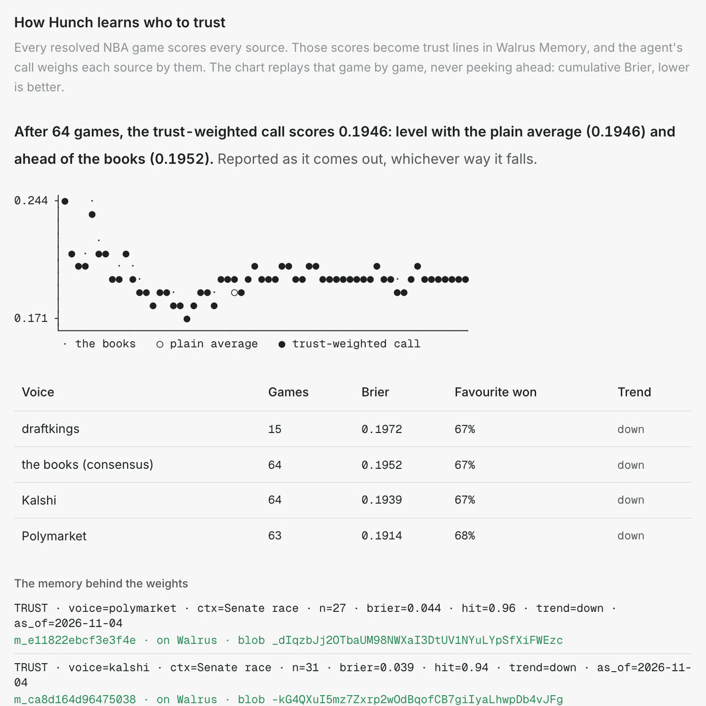
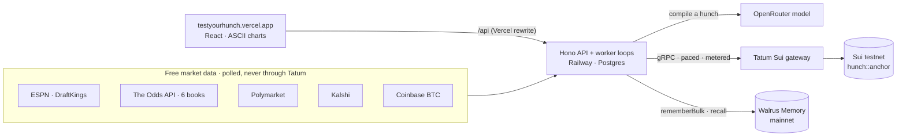
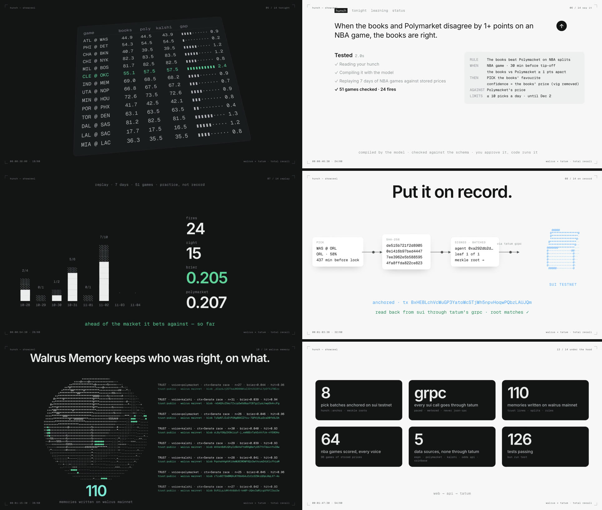

<p align="center">
  <picture>
    <source media="(prefers-color-scheme: dark)" srcset="docs/media/banner-dark.png" />
    
  </picture>
</p>

<p align="center">
  <a href="https://testyourhunch.vercel.app"></a>
  
  
  
  
  <a href="LICENSE"></a>
</p>

<p align="center">
  <b>Say it, Hunch tests it, Sui proves it, Walrus Memory learns who to trust.</b><br />
  <a href="https://testyourhunch.vercel.app">Live app</a> ·
  <a href="https://youtu.be/gHsQ5GAh2VE">Watch the 2-minute film</a> ·
  <a href="docs/prd.md">PRD</a> ·
  <a href="docs/adr/README.md">Decisions</a>
</p>

<p align="center">
  <a href="https://youtu.be/gHsQ5GAh2VE">
    
  </a>
  <br /><sub>Eight seconds of the showreel. Click for the full 2-minute film on YouTube, or <a href="https://github.com/UyLeQuoc/total-recall-hunch/releases/download/showreel-2026-11-04/hunch-showreel.mp4">download the mp4</a> (1080p60, sound on).</sub>
</p>

---

Everyone who bets or forecasts has hunches, like "Polymarket overprices NBA favourites" or "the books are
sharper than Kalshi". Almost nobody tests them honestly: wins stick, losses fade, and nobody can say which
source to trust for what.

**Hunch is where a hunch gets tested before money touches it.**
1. You say it in plain words, and Hunch compiles it into a rule you can read.
2. It replays the rule on the last 7 days of real prices.
3. Then it puts the rule **on record**: every pick is logged before lock and anchored on Sui, so no loss can
   be hidden.
4. Every morning every voice is scored, and Walrus Memory keeps who was right, on what.

A rule that beats the market it bet against earns **Proven**.

A Track 1 entry (Markets & Sports Prediction) to the
[Walrus × Tatum "Total Recall" hackathon](https://recall-tatum-walrus.vercel.app). Not a sportsbook: no
deposits, no wagering, no real money.

## The loop

<table>
  <tr>
    <td width="50%" valign="top">
      <b>1 · Say it, test it</b><br />
      <sub>A model compiles the hunch into a typed rule, checked against a schema. Then the rule is replayed
      on stored prices from the books, Polymarket and Kalshi. This one ran on 51 games: 24 fires, 15 right,
      Brier 0.205 against Polymarket's 0.207.</sub><br /><br />
      
    </td>
    <td width="50%" valign="top">
      <b>2 · Every source, side by side</b><br />
      <sub>Each of tonight's games shows every source next to the others, with splits flagged. The agent's
      call is weighted by what memory says each source has earned, and it cites the memory blobs.</sub><br /><br />
      
    </td>
  </tr>
  <tr>
    <td width="50%" valign="top">
      <b>3 · On record, provably</b><br />
      <sub>Each pick is hashed, signed by Hunch's agent under the owner's delegation, batched into a Merkle
      root, and anchored on Sui. Anyone can run the seven checks. The anchor is read back through Tatum's
      gRPC, and a late pick gets a 409.</sub><br /><br />
      
    </td>
    <td width="50%" valign="top">
      <b>4 · It learns who to trust</b><br />
      <sub>Every resolved game scores every voice. The scores become trust lines on Walrus Memory, and the
      learning chart compares the trust-weighted call with the plain average and the books. It reports the
      result game by game, whichever way it falls.</sub><br /><br />
      
    </td>
  </tr>
</table>

## How it uses Walrus Memory

Postgres does the math. **Walrus Memory on mainnet holds the conclusions the product acts on,** one typed
line per memory ([ADR-0012](docs/adr/0012-scoring-and-trust-memory.md)).

| Namespace      | Line                                                                                                                  | What reads it                             |
| -------------- | --------------------------------------------------------------------------------------------------------------------- | ----------------------------------------- |
| `trust:public` | `TRUST · voice=kalshi · ctx=Senate race · n=31 · brier=0.039 · hit=0.94 · trend=down · as_of=2026-11-04` (on mainnet) | The agent's weights, recalled per context |
| `radar:public` | `SPLIT · NBA ML · <a> vs <b> · ≥5 pts at lock · <a> closer <right> of <n> · lean=<winner>`                            | The radar's learned lean                  |
| `rules:<user>` | `RULE` and `PROVEN` lines: what a user believes, and which hunches held up                                            | The user's record                         |
| `picks:<user>` | `PICK` lines, each with its anchor                                                                                    | "What did I say last time"                |

- **Written in batches:** `rememberBulk`, with an idempotency key per snapshot, through a Postgres queue. A
  restart never writes a line twice.
- **Recalled on every page:** recall goes through a stale-while-revalidate cache, so a page never waits on
  the relayer.
- **The agent's call shows its sources:**
  "Leaning on Polymarket for NBA moneylines (n=63, Brier 0.191)", with the blob id beside it.
- **Measured on Nov 4: 110 lines written on mainnet.** Lines from test accounts are parked and never sent,
  because memories can't be deleted. The relayer's real limits and quirks are in
  [docs/tech-reference.md §1.11](docs/tech-reference.md#111-field-notes-measured-on-mainnet).

## How it uses Tatum and Sui

**Every Sui call goes through `@hunch/chain`:** Tatum's native gRPC gateway, paced to 3 calls a second,
retried on 429s, with every call and stream frame counted against a daily credit budget
([ADR-0002](docs/adr/0002-sui-grpc-only.md), [ADR-0003](docs/adr/0003-tatum-for-every-sui-call.md)).
It's gRPC only, never JSON-RPC. While Tatum answers 402, calls fall back to the public fullnode
([ADR-0004](docs/adr/0004-public-fullnode-fallback-on-402.md)).

- **`hunch::anchor` on testnet:** `0xa3467ed7cbae2b4bd216711baefed11bcdc2d417f2c6bb49b47d5be2b4c3370a`.
  - It emits one event per Merkle batch of picks, with sponsored gas.
  - The first anchor is `BxHEBLchVcWuGP3YatoWcSTjWh5npvHoqwPQbzLAUJQm`, and 8 batches are anchored so far.
- **Anchoring:** the anchor loop signs and executes each batch through Tatum.
- **The proof page** (`/p/<id>`) reads the transaction back through Tatum and checks its root against the
  pick's Merkle proof.
- **Market data never touches Tatum.** It comes from free sources:
  - ESPN (DraftKings);
  - The Odds API (FanDuel, BetMGM, Caesars, Pinnacle, Betfair);
  - Polymarket, Kalshi, and Coinbase for BTC.

## Architecture



The worker loops ingest prices, monitor rules on record, sign and anchor picks, resolve and score, and
write memory. Deploys: the web app is on Vercel and the API on Railway
([ADR-0016](docs/adr/0016-deploy-railway-and-vercel.md), [ADR-0017](docs/adr/0017-railway-footprint.md)).

## By the numbers

Measured from the live app on Nov 4, 2026:

| What                                                      | Measured                                                     |
| --------------------------------------------------------- | ------------------------------------------------------------ |
| Memories written on Walrus mainnet                        | **110**                                                      |
| Pick batches anchored on Sui testnet, through Tatum       | **8**                                                        |
| NBA games scored, every voice                             | **64**: Polymarket 0.1914 · Kalshi 0.1939 · the books 0.1952 |
| The trust-weighted call after 64 games                    | **0.1946**: level with the plain average, ahead of the books |
| The demo hunch's replay (books vs Polymarket, 1+ point)   | **24 fires, 15 right**, Brier 0.205 vs Polymarket's 0.207    |
| Games of stored prices for replays · BTC 5-minute candles | **96** · **2,575**                                           |
| Tests passing                                             | **126**                                                      |

## The film

<p align="center">
  
</p>

The 2-minute showreel is **rendered from code** in [`apps/video`](apps/video/README.md)
([ADR-0019](docs/adr/0019-showreel-in-hunchs-own-look.md)):

- **The look is the site's:** ASCII motion drawn on a character grid, with a lit sphere for Walrus Memory
  and a cube for Sui.
- **The music** is synthesised in code at 120 BPM.
- **Every number on screen** is measured from the live API at render time. The same pipeline drew the
  banner above.

```bash
cd apps/video && bun data.ts && bun shots.ts && bun render.ts   # → out/hunch.mp4
```

## Status (Nov 4, 2026)

The whole happy path runs on real data (PRD §5).

| Step   | What runs                                                                                                               | Notes                                                                                                                    |
| ------ | ----------------------------------------------------------------------------------------------------------------------- | ------------------------------------------------------------------------------------------------------------------------ |
| 1–2    | Say a hunch: a rule card and a 7-day replay against the books, Polymarket and Kalshi (NBA), or Coinbase (BTC)           | Any wording with `OPENROUTER_API_KEY`; the example shapes without it ([ADR-0008](docs/adr/0008-first-runnable-slice.md)) |
| 3–4    | **See one scored now:** a BTC practice pick, scored 5 minutes later                                                     |                                                                                                                          |
| 5      | Sign in once: a Sui wallet or a browser test key signs the delegation                                                   | [ADR-0011](docs/adr/0011-picks-on-record.md)                                                                             |
| 6–8    | Put it on record: the monitor fires before tip-off or before the polls close, signs the pick, and notifies with Undo    | Picks by hand on **tonight** too; late picks get 409                                                                     |
| 9      | Research card: every source side by side, splits flagged, the agent's call citing its memory                            | NBA and the Senate races ([ADR-0013](docs/adr/0013-odds-api-and-senate-races.md))                                        |
| 10, 12 | Resolve, score every voice, write trust lines to Walrus Memory on mainnet; the call leans on them and cites their blobs | [ADR-0012](docs/adr/0012-scoring-and-trust-memory.md)                                                                    |
| 11     | `/p/<id>`: hash, signatures, delegation, Merkle proof, anchor read back from Sui through Tatum                          | [ADR-0010](docs/adr/0010-anchor-module-and-localnet.md)                                                                  |
| 13     | Proven per version (n ≥ 20 and a better Brier than its market), scorecards, the learning chart                          |                                                                                                                          |
| 14     | Trading on DeepBook Predict (P1) and the Predict spike (H12)                                                            | Not built: needs test USDC ([ADR-0014](docs/adr/0014-predict-spike.md))                                                  |

The look is one prompt column, with every chart drawn in ASCII ([ADR-0009](docs/adr/0009-the-look.md)).

## Layout

```
apps/api          Hono API and worker loops: ingest, compiler, monitor, anchor (sign, batch, verify),
                  score (voices, trust, Proven), memory (queue → Walrus), auth (delegation)
apps/web          React: hunch, tonight, learning, status, your record, rule and proof pages;
                  ASCII charts in src/lib/ascii
apps/video        The showreel and the banner, rendered from code; the score, synthesised
packages/chain    @hunch/chain: Tatum Sui gRPC client, pacing, credit counting, 402 fallback, logger
packages/memory   @hunch/memory: Walrus Memory namespaces, limiter, account reads, sign-in
packages/move     hunch::anchor (one event per Merkle batch)
docs/             PRD, ADRs, tech reference, code rules, event rules
```

## Develop

Needs Bun 1.3.14, Node 24, Docker and, for anchors, the Sui CLI.

```bash
bun install
cp .env.example .env     # every key is optional; see the status table for what each unlocks
bun run keys:dev         # a test agent key, so picks can go on record
bun run db:up            # Postgres on localhost:5437
bun run dev              # API on :8787, web on http://localhost:5290
```

The first start backfills the last 7 days, which takes about a minute. Without `OPENROUTER_API_KEY`,
only hunches shaped like the three examples compile. With it, any wording does.

**End to end on your machine, anchors included** ([ADR-0015](docs/adr/0015-local-end-to-end.md)):

```bash
bun run localnet         # in its own terminal: a throwaway Sui localnet and hunch::anchor, lines in .env
bun run dev              # restart it after the localnet is up
```

Then try the record end to end:
1. Sign in with **Use a test key**.
2. Put an NBA or Senate rule on record, or log a pick on **tonight**.
3. Undo one, and open its proof. Within a minute the batch is anchored and every check is green.

Ctrl-C on the localnet takes its lines back out of `.env`.

Checks: `bun run typecheck && bun run lint && bun run test && bun run docs:links`, and `sui move test`
in `packages/move/hunch`.

Agents: read [AGENTS.md](AGENTS.md).

## License

[MIT](LICENSE)
