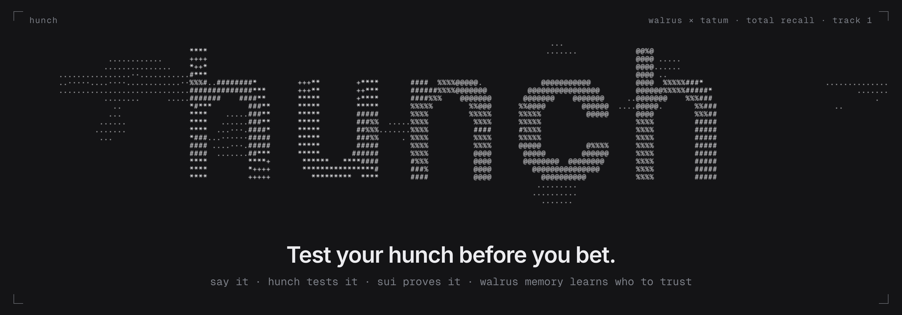
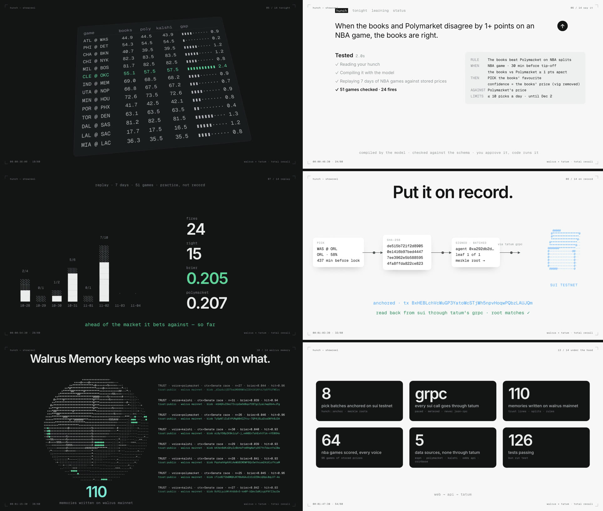
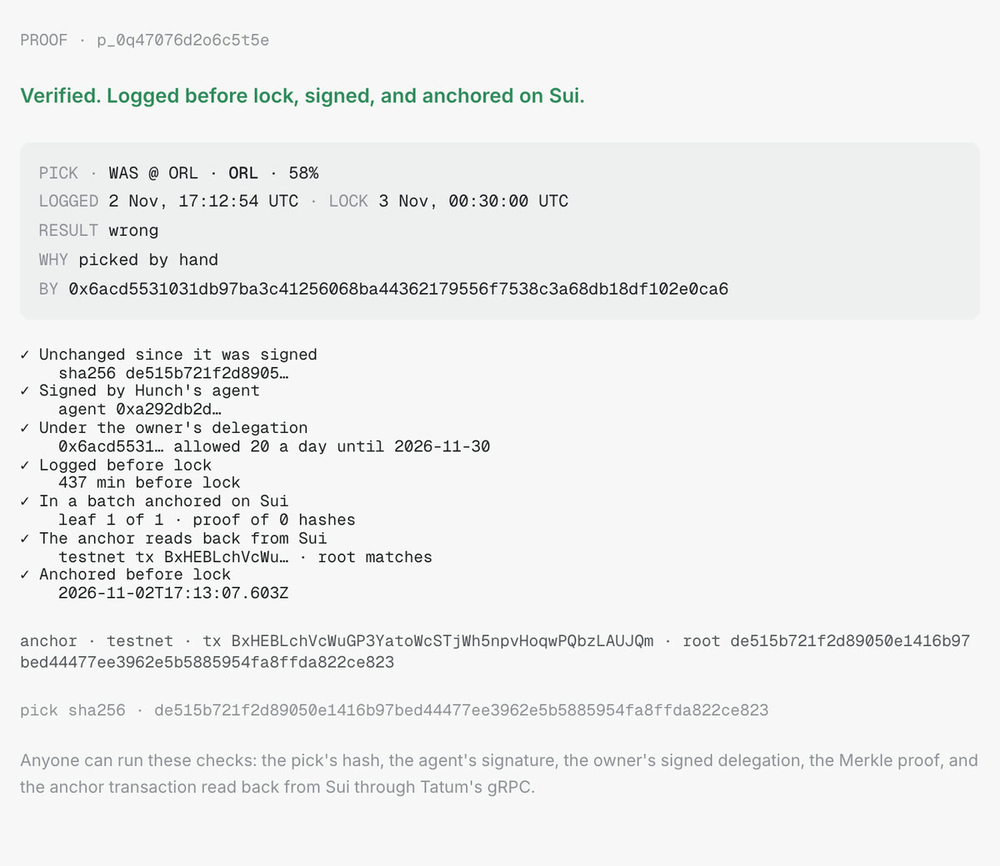
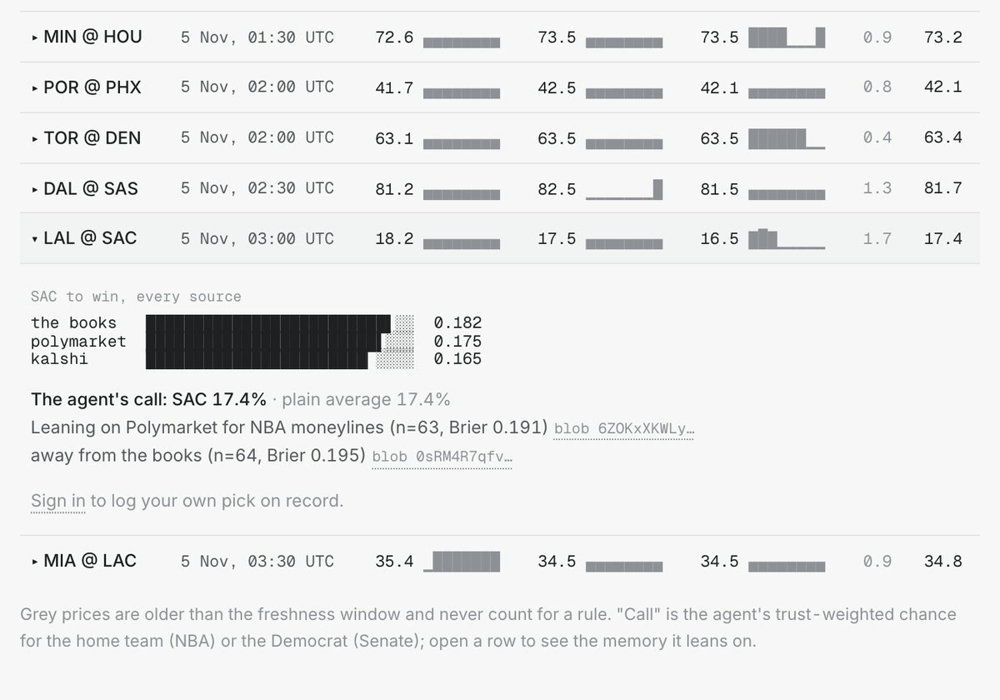
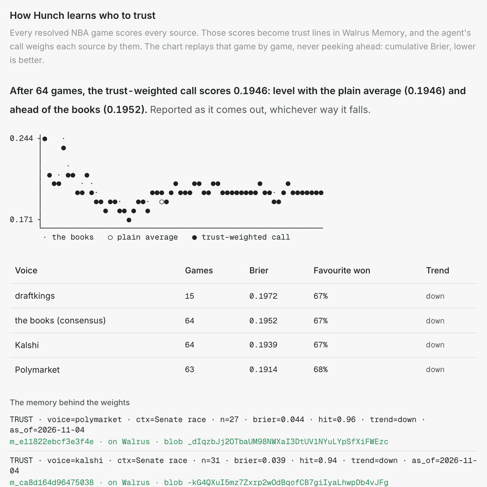

# Hunch: test your hunch before you bet

_How Hunch uses Tatum and Walrus Memory, and what it has learned so far. A Track 1 entry to the
Walrus × Tatum "Total Recall" hackathon._



**Live:** https://testyourhunch.vercel.app · **Video (2 min):** https://youtu.be/gHsQ5GAh2VE ·
**Code:** https://github.com/UyLeQuoc/total-recall-hunch

---

## Everyone has a hunch

If you follow sports or elections, you have hunches:
- "Polymarket overprices NBA favourites."
- "The books are sharper than Kalshi."
- "When the books and Polymarket disagree, the books are right."

Almost nobody tests them honestly. Wins stick and losses fade. Nobody can tell you which source to trust
for which kind of game, because nobody keeps score.

Hunch keeps score. It's the place a hunch gets tested before money touches it. Hunch isn't a sportsbook:
no deposits, no wagering, no real money.

## What it does



1. **Say it.** You type the hunch in plain words. A model compiles it into a typed rule you can read. The
   rule is checked against a schema, and Hunch asks the model again if it slips. For example:
   - WHEN an NBA game is 30 minutes from tip-off and the books and Polymarket are at least 1 point apart;
   - THEN pick the books' favourite, at the books' price;
   - AGAINST Polymarket.

2. **Test it.** The rule is replayed on 7 days of prices Hunch already stored from the books (DraftKings
   via ESPN, plus FanDuel, BetMGM, Caesars, Pinnacle and Betfair via The Odds API), Polymarket and Kalshi.
   The replay of that rule ran over 51 games:
   - it fired 24 times and was right 15 times;
   - its Brier score was 0.205, against Polymarket's 0.207 on the same games.

   That's ahead of the market it bets against, by a hair, so far.
3. **Put it on record.** From then on a monitor fires the rule's picks before lock. Each pick is hashed,
   signed by Hunch's agent under a delegation you signed once, batched into a Merkle tree, and anchored on
   Sui. A pick that arrives after tip-off is refused with a 409. A pick that loses stays on the record.
4. **Prove it.** Every morning the results come in and every voice is scored:
   - your rule;
   - the books;
   - Polymarket;
   - Kalshi.

   After 20 picks on record, a rule that beats the market it bet against earns **Proven**.

## How it uses Tatum

Sui is the notary, and Tatum is how Hunch talks to it. **Every Sui call goes through one small client,
`@hunch/chain`,** over Tatum's native gRPC gateway with the API key as metadata. There's no JSON-RPC
anywhere.

- **Anchoring.** A Move module on testnet, `hunch::anchor`, emits one event per Merkle batch.
  - Hunch simulates and executes each batch through Tatum, with gas sponsored so users hold no SUI.
  - 8 batches are anchored so far. The first is
    [`BxHEBLchVcWuGP3YatoWcSTjWh5npvHoqwPQbzLAUJQm`](https://suiscan.xyz/testnet/tx/BxHEBLchVcWuGP3YatoWcSTjWh5npvHoqwPQbzLAUJQm).
- **Verifying.** Every pick has a proof page that anyone can open. It runs seven checks:
  - the hash is unchanged;
  - the agent's signature is valid;
  - the owner's delegation covers the pick;
  - the pick was logged before lock;
  - the pick is in a Merkle batch;
  - the anchor reads back from Sui through Tatum;
  - the anchor landed before lock.
- **Budgeted.** The client paces calls to 3 a second and retries Tatum's 429s. It counts every call and
  stream frame against a daily credit budget, which the status page shows. If Tatum answers 402, calls
  fall back to a public fullnode until it recovers.
- **Market data never touches Tatum.** Prices come from the free sources above. Tatum's credits go to what
  only a chain can do: making the record impossible to rewrite.



## How it uses Walrus Memory

Postgres does the math. **Walrus Memory on mainnet holds the conclusions the product acts on,** one
typed line per memory, in namespaces built in one place:

```
TRUST · voice=kalshi · ctx=Senate race · n=32 · brier=0.037 · hit=0.94 · trend=down · as_of=2026-11-04
SPLIT · NBA ML · <a> vs <b> · ≥5 pts at lock · <a> closer <right> of <n> · lean=<winner>
RULE · v1 · The books beat Polymarket on NBA splits · …
PROVEN · rule=… · n=… · brier … vs polymarket …
PICK · 2026-11-04T23:30Z · rule=… · LAL ML · conf=0.58 · anchor=<digest>
```

- **Writing:** after each resolution, Hunch scores every voice per context ("NBA moneyline", "Senate
  race"). It then writes the snapshots with `rememberBulk`, using an idempotency key per snapshot, from a
  Postgres queue. A crash or a retry never writes a line twice, and Postgres keeps a copy of every line
  with its blob id.
- **Reading:** the agent's call for every game recalls the TRUST lines for that context and weighs each
  source by its record. It says so in a sentence that cites the memory's blob:

  > The agent's call: OKC 56.7%. Leaning on Polymarket for NBA moneylines (n=63, Brier 0.191), away from
  > the books (n=64, Brier 0.195).

  Recall goes through a stale-while-revalidate cache, so a page never waits on the relayer.
- **Safety:** memories can't be deleted, and the relayer sees plaintext. So nothing private is written,
  and lines from test accounts are parked instead of sent.
- **Measured:** **110 lines written on mainnet** as of Nov 4. We also wrote down what the relayer
  actually does: limits, latency, recall distances, and where the docs drifted. Those notes are in the
  repo's tech reference for the next builder.



## How it learned over time

The point of memory is that the product behaves differently tomorrow because of what happened today. All
of these numbers are measured from the live app, and they're reported whichever way they fall.

**NBA moneylines, after 64 games** (cumulative Brier, lower is better):

| Voice                 | Games | Brier  |
| --------------------- | ----- | ------ |
| Polymarket            | 63    | 0.1914 |
| Kalshi                | 64    | 0.1939 |
| The books (consensus) | 64    | 0.1952 |
| DraftKings alone      | 15    | 0.1972 |

So the agent now **leans on Polymarket and away from the books** for NBA moneylines, and it cites the
memory that says why. That's the opposite of the hunch most people start with: "the books are sharper".

**The learning chart** replays it game by game and never peeks ahead. After 64 games the trust-weighted
call scores **0.1946**:
- level with the plain average of the sources (0.1946);
- ahead of the books on their own (0.1952).

The edge is a few thousandths. It's real, and small, and we show it as it is.

**The Senate races, election night.** The races locked when the first polls closed on Nov 3, and resolved
overnight. By the morning of Nov 4, the TRUST lines on Walrus read:
- **Kalshi:** Brier 0.037 over 32 races;
- **Polymarket:** Brier 0.044 over 27 races.

For Senate races, the agent's weights moved toward Kalshi. That's a different answer from the NBA one,
which is the whole reason trust is kept per context.

**What changes next.** Every night adds games, and every game moves the weights. A rule on record that
reaches 20 picks and beats its market earns Proven. The line that says so goes to Walrus too, so the
next agent that reads this account knows which hunches held up.



## How it's built

- **API:** Bun and Hono on Railway, with worker loops and Postgres. The loops ingest prices, monitor
  rules, sign and anchor picks, resolve and score, and write memory.
- **Web:** React on Vercel. One prompt column, every chart drawn in ASCII.
- **Packages:**
  - `@hunch/chain`: Tatum, Sui gRPC, pacing, the credit meter, the fallback;
  - `@hunch/memory`: Walrus Memory namespaces, the relayer's rate limiter, delegate set-up;
  - `hunch::anchor`: the Move module.
- **The compiler:** an OpenRouter model, with a schema repair loop and a pattern compiler as the fallback.
- **The film:** the 2-minute video is rendered from code in the repo, and its music is synthesised in
  code too.

Every decision is an ADR in the repo, and the whole thing runs locally on a throwaway Sui localnet with
one command.

## What's next

- **Trading a proven rule:** a proven BTC rule could trade on DeepBook Predict, Sui's prediction market,
  on testnet and within its limits.
- **User-owned memory:** each user's rules and picks would live in their own Walrus Memory account.

---

_Built for the Walrus × Tatum "Total Recall" hackathon, Track 1: Markets & Sports Prediction. MIT
licensed. Try it at https://testyourhunch.vercel.app._

_Tags: @Tatum_io @WalrusFoundation #Sui #Walrus #Tatum_
