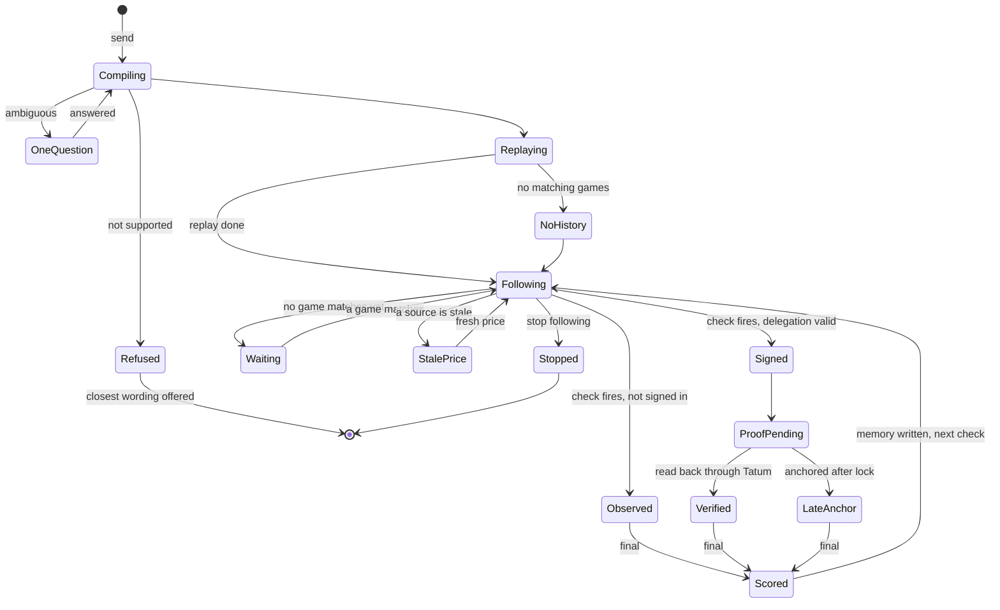

# UX plan: new features, still one sentence

| Field      | Value                                                                                                                |
| ---------- | -------------------------------------------------------------------------------------------------------------------- |
| **Date**   | Nov 3, 2026                                                                                                          |
| **From**   | Harry Phan, after using the live app at testyourhunch.vercel.app (desktop 1280 wide, phone 390 wide)                |
| **Status** | Proposed. Concept screens only; nothing here is built. Each accepted change gets an ADR (AGENTS.md)                 |
| **Builds on** | [product-feedback.md](product-feedback.md) (what it should feel like), [build-now.md](build-now.md) (charts and days) |

**The rule for every feature below:** the user still types one sentence and reads one answer. A new
feature may add a line, a chart or a fold under that answer. It may not add a page, a mode, a setting
or a step before the answer. The look stays as [ADR-0009](adr/0009-the-look.md) set it: one prompt
column, ASCII charts, Inter and Geist Mono.

The concept screens are on a private design canvas (Hunch UX concepts) made for this review. It has
three variants of the answer, the research card, a pick's proof, the return visit, and two phone
screens, all drawn from real data the live API served on Nov 3 (`/api/games`, `/api/learning`, the NBA
example's replay). The owner can ask for the link; it opens only once shared.

## 1. What the live app does today (seen on Nov 3)

| # | Seen | Why it matters |
| :- | :--- | :--- |
| 1 | After the replay, the three actions are "See one scored now", "Put it on record" and "Edit". The first runs a **BTC** practice pick under an **NBA** hunch | The next step leaves the user's own hunch (product-feedback §8) |
| 2 | Nothing says what happens next. The monitor follows a rule only once it is on record or its owner has signed in (`monitor/record.ts:39`), so a visitor's hunch is never followed | One sentence ends in a report, not a process (product-feedback §3) |
| 3 | The replay shows bars per day and one Brier number each, but no price over time | The split the hunch is about is never drawn (build-now §2) |
| 4 | `/tonight` typed into the address bar shows "Nothing here"; the nav's "tonight" goes to `/games` | A shared or typed link to tonight is broken |
| 5 | On a phone, the tonight table is 647 px wide in a 358 px box, so Polymarket, Kalshi, Gap and Call sit behind a sideways scroll (measured with `scrollWidth`) | The comparison is the point of the page, and on a phone you can't see it |
| 6 | The research data already has the call, the plain average, each source's weight and the memory it cites (`/api/games` `call.lines[].cites`, with `memoryId` and `blobId`) | "Why this call" needs no new backend, only a screen |
| 7 | For tonight's games the weighted call and the plain average differ by under 0.1 point (PHI @ DET: 51.13 against 51.14) | The honest line "Memory was updated. It did not change this call." is the true one today |

## 2. Every job, by who does it

Priority: **P0** for the demo and submission, **P1** if a day frees up, **P2** after the hackathon.

| Role | Job | Today | New | Priority |
| :--- | :--- | :--- | :--- | :- |
| Visitor (no wallet) | Say a hunch and see it tested | Works | Same sentence, answer in three lines (PAST, NEXT, LEARNED) | P0 |
| Visitor | Know what happens next | Missing | NEXT says the next game and time, or what it is waiting for | P0 |
| Visitor | Keep it running without setting anything | Missing (the monitor skips visitors' rules) | Following starts on send, as observations; "Stop following" ends it | P0 |
| Visitor | See the split the hunch is about | Missing | The gap against the rule's line, and every source on one time axis | P0 |
| Visitor | Answer one question when the hunch is ambiguous | Works (H1) | Kept, as two buttons instead of prose | P1 |
| Visitor | Try the fast BTC path on purpose | Mixed into the NBA answer | Its own example chip: "Try a five-minute BTC hunch" | P0 |
| Signed in | Sign once, then picks go on record by themselves | Works, behind "Put it on record" | One "Sign in to put picks on record" button under the answer | P0 |
| Signed in | See each pick's proof without opening it | Works on `/p/<id>` only | Chips on the pick: before tip-off, signed, Sui proof pending, verified | P0 |
| Signed in | Undo before the lock | Works | Kept; the chip row says until when | P0 |
| Signed in | Know when an anchor came after the lock | Missing | Said in one plain line | P1 |
| Anyone on tonight | Compare every source on a phone | Hidden behind a sideways scroll | One card per game with all three prices, the gap and the call | P0 |
| Anyone on tonight | See why Hunch leans one way | Text lines only | "Why this call": weights, Brier, sample sizes, weighted against plain, links to the memory | P0 |
| Anyone on tonight | See when the hunch disagrees with Hunch | Missing | "Your hunch follows the books. Hunch's evidence leans on Polymarket." | P1 |
| Returning user | Know what changed since last time | Missing | "Since you asked": resolved picks, right count, still too early or not | P1 |
| Returning user | See every result, losses included | Works on the rule page | One fold under the answer | P1 |
| Returning user | Edit without rewriting history | Works (versions) | Button says "Edit (starts version 2)" | P2 |
| Judge or anyone with a link | Verify a pick on Sui | Works on `/p/<id>` | A timeline: picked, anchored, lock, final, scored | P0 |
| Judge | Trace a call to the memory that made it | Partly (cites on tonight) | Each trust bar links its memory line and blob | P0 |
| Owner | Watch credits, anchors and memory writes | Works (`/status`) | No change | P2 |

## 3. The new features, kept simple

1. **The answer in three lines.** Under the headline: PAST (the replay in one sentence), NEXT (what
   Hunch is doing now), LEARNED (how much to trust it yet). Everything else, the rule card and the
   replay bars included, folds under one "Details" button.
2. **Following on send.** Sending the hunch starts following it on the server. The only control is
   "Stop following". Signing in adds signed picks; it never gates the following.
3. **The live split card.** Under NEXT, the game being watched: each source's price as one bar and the
   gap against the user's line.
4. **Why this call.** On the research card: trust per source (weight, Brier, games), weighted against
   plain average, and the memory lines it read. When the two numbers are the same, it says so.
5. **Proof as chips.** A pick shows "✓ before tip-off · ✓ signed · Sui proof pending…", then "✓
   verified on Sui" with a verify link. The full checks stay on `/p/<id>`.
6. **Since you asked.** Reopening a hunch starts with what changed and how sure it is, then the rows.
7. **Tonight as cards on a phone.** Under 640 px wide, each game becomes a card with every price
   visible. The table stays on desktop.
8. **BTC on its own.** "See one scored now" leaves the NBA answer and becomes a "Try a five-minute BTC
   hunch" example.
9. **Small fixes found on the way.** `/tonight` serves the tonight board (redirect or route alias); the
   game row opens from the keyboard (product-feedback §11).

## 4. Three ways to show the answer

| | A · Ledger | B · Story | C · Chart first |
| :--- | :--- | :--- | :--- |
| Shape | Headline, then PAST, NEXT, LEARNED as a two column list, the live split card, one fold | A vertical timeline: tested, following, next check, after the final | The gap chart on top, one sentence, four chips |
| Best at | Reading in five seconds; same shape for every state | Showing that it keeps going over time | Showing the split the hunch is about |
| Weak at | Less sense of time passing | Longer; the future steps are empty at first | Needs a live split to draw; weaker with no matching game |
| Phone | Fits in one screen (concept at 390 × 844) | Scrolls | The chart needs about 330 px of mono width |

**Recommendation: A, with C's gap chart inside its live split card once a matching game is near its
check.** A holds every state in the same three lines (testing, watching, observation, no match yet, no
history), so it stays simple when the data is not friendly. B's timeline is the right shape for the
return visit (§3 item 6), so it is reused there instead of on the first answer.

## 5. States of one hunch

Each state has one line of copy in the answer's NEXT row, so the user always reads what Hunch is doing
and never a log. The concept's Ledger screen has a switch for six of them (watching, testing,
observation, no match yet, no history, ambiguous).

## 6. What to try to break when it's built

1. Double click "Sign in to put picks on record", "Log on record" and "Undo": one action each, the
   button disabled while it runs (product-feedback §11 has the server side).
2. Send a hunch, close the tab during the replay, reopen: the same hunch is there and following.
3. Cut the network mid stream: the answer says what was lost and offers a retry, never an empty "done".
4. Keyboard only: send, open Details, open a game card, open "Why this call", Undo.
5. The longest realistic values: a 400 character hunch (the API's limit), a 66 character Sui address
   and a 44 character blob id in the proof chips, team names like "Trail Blazers": no sideways scroll at
   390 px.
6. A source missing (no books price), a stale price, memory unreadable, an anchor after lock: each shows
   its own one line from §5.
7. Contrast: every grey label at 4.5:1 or better on both themes (today's light `--ink-3` is about 3.0:1).

## 7. Checklist

1. [ ] The answer in three lines, with Details folding the rule card and the replay.
2. [ ] Following starts on send; "Stop following" is the only control.
3. [ ] NEXT names the next game and time, or what it is waiting for.
4. [ ] The live split card, and the gap chart near a check.
5. [ ] "Why this call" with weights, Brier, sample sizes, weighted against plain, memory links.
6. [ ] Proof chips on every pick, and the timeline on `/p/<id>`.
7. [ ] "Since you asked" on a returning visit.
8. [ ] Tonight as cards under 640 px.
9. [ ] BTC as its own example, out of the NBA answer.
10. [ ] `/tonight` works as a link.
11. [ ] Every item in §6 tried and passing, with desktop (1280 × 800) and phone (390 × 844) before and
    after screenshots and a recorded walkthrough in the PR that builds it.
